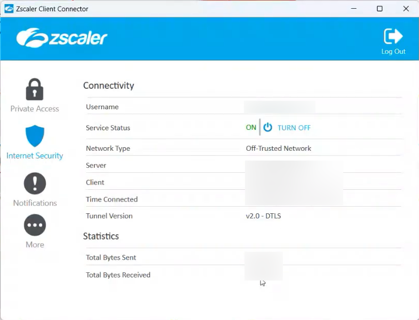
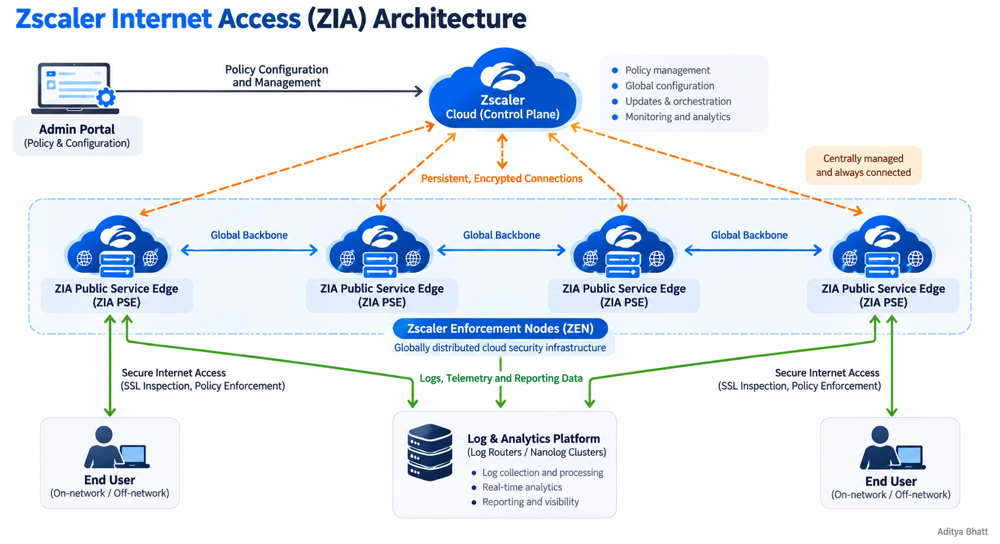

# Zscaler Internet Access (ZIA): Understanding the Architecture Behind Cloud-Delivered Security

**Author:** Aditya Bhatt  
**Topics:** Cloud Security, Secure Web Gateway, Zero Trust, Network Security, Zscaler

## Introduction

As organizations move toward cloud-first environments and distributed workforces, securing internet access can no longer depend entirely on traditional perimeter-based security appliances.

Employees access web applications, SaaS platforms, and internet resources from corporate offices, home networks, and public networks. Maintaining consistent security policies across these environments requires an architecture that can inspect and control traffic without forcing every connection through a centralized corporate data center.

This is where **Zscaler Internet Access (ZIA)** comes into the picture.

ZIA is a cloud-delivered security service that acts as a secure gateway between users and internet destinations. It inspects traffic, applies organizational security policies, and helps protect users against malicious content, unauthorized access, and data exposure.

In this article, we will explore the fundamental architecture of ZIA, understand how its major components interact, and follow the general journey of a user's traffic through the service.

  

*Figure 1: The user end ZIA UI.*

---

## 1. What Is Zscaler Internet Access?

Zscaler Internet Access is a cloud-delivered Secure Web Gateway (SWG) and internet security platform.

Instead of relying exclusively on security appliances deployed at an organization's physical perimeter, ZIA provides security inspection and policy enforcement through its distributed cloud infrastructure.

Depending on the organization's subscriptions and configuration, its capabilities can include:

- URL filtering and web access control
- Firewall policy enforcement
- SSL/TLS inspection
- Malware and advanced threat protection
- Cloud application control
- Data Loss Prevention (DLP)
- Security visibility, logging, and reporting

The objective is to apply consistent security controls to user traffic, regardless of whether a user is working from a corporate office or a remote location.

An important distinction: **ZIA is primarily concerned with securing access to the internet and SaaS applications.** Zscaler Private Access (ZPA), by comparison, focuses on providing access to private applications without requiring traditional network-level access.

---

## 2. Understanding the ZIA Architecture

The ZIA architecture consists of several interconnected components responsible for configuration management, traffic inspection, policy enforcement, and logging.

   

*Figure 2: A conceptual representation of ZIA's control plane, distributed service edges, user traffic, and logging infrastructure.*

The diagram uses four illustrative service-edge nodes to explain the architecture. It is a conceptual representation, not a map of an actual Zscaler deployment or a statement about the number of nodes in a production environment.

### 2.1 Admin Portal

The Admin Portal is the administrative interface through which authorized administrators configure and manage the ZIA environment.

Depending on their assigned permissions, administrators can use the console to manage:

- Security policies and rule configuration
- User, group, and location settings
- Traffic-forwarding configuration
- Security controls and inspection settings
- Reporting and operational visibility

The Admin Portal provides the management interface; it is not the component through which every user's internet session must pass.

### 2.2 Central Authority (CA)

The Central Authority is a core control-plane component of the ZIA cloud.

It provides centralized management of customer policy and configuration information, as well as software and database updates and other cloud-management functions.

At a high level, the relationship works as follows:

1. An administrator defines the required policies and configuration.
2. The configuration is managed through ZIA's control plane.
3. Relevant policy and configuration information is made available to the service infrastructure.
4. Service edges enforce the applicable policies when processing user traffic.

This separation between centralized management and distributed enforcement is an important architectural concept.

The control plane manages the configuration, while the service edges handle traffic inspection and enforcement.

### 2.3 ZIA Public Service Edge (ZIA PSE)

The ZIA Public Service Edge is one of the most important components in the architecture.

Public Service Edges are cloud-hosted security gateways that process internet-bound traffic, inspect requests, and enforce applicable security policies.

Depending on the traffic and configuration, inspection can involve firewall controls, web security policies, threat protection, and other enabled security capabilities.

The basic sequence is:

1. User traffic reaches an appropriate ZIA service edge through a configured traffic-forwarding method.
2. The service identifies the relevant user, location, or other applicable context.
3. Security policies and inspection controls are evaluated.
4. The request is allowed, blocked, or otherwise handled according to the applicable policies.
5. Permitted traffic is forwarded toward its destination.

A distributed service-edge architecture allows organizations to protect users in different locations without depending solely on a single corporate internet gateway.

### 2.4 Zscaler Enforcement Node (ZEN)

The term **ZEN (Zscaler Enforcement Node)** is sometimes used in discussions of Zscaler's enforcement infrastructure.

For clarity, ZIA's official product documentation uses the term *Public Service Edge* for its internet security gateways. This article therefore uses **ZIA Public Service Edge (ZIA PSE)** as the primary component name and treats ZEN as an explanatory label rather than a separate architectural tier.

The important concept is that security enforcement occurs within the service infrastructure that processes the user's traffic.

### 2.5 Log Routers and Nanolog

Traffic inspection is only one part of a security platform. Organizations also need visibility into what happened, which policies were triggered, and why a request was allowed or blocked.

ZIA generates transaction and security-related log information that can be processed and made available for reporting and analysis.

At a conceptual level:

- **Service edges** process traffic and generate relevant log information.
- **Log routers** help route log data through the logging infrastructure.
- **Nanolog-related infrastructure** supports the handling and availability of log data for supported reporting and analytics workflows.

These components provide visibility into security events and user activity.

Actual log delivery, retention, and access depend on the applicable ZIA services, configuration, and integrations. The logging path should not be confused with the normal user traffic path.

---

## 3. How Does Traffic Flow Through ZIA?

Let's walk through a simplified example.

Imagine an employee opens a browser and attempts to access a website.

### Step 1: Traffic forwarding

The user's traffic is directed to the ZIA service using a configured forwarding mechanism.

Depending on the environment, this may involve Zscaler Client Connector, a tunnel from a network or security device, a PAC file, or another supported forwarding method.

The forwarding method determines how the traffic reaches the ZIA service.

### Step 2: Authentication and identification

ZIA needs sufficient context to associate traffic with the appropriate user, location, or other configured identity information.

Authentication and user provisioning help the service apply the correct policies and provide meaningful user-level visibility.

The precise authentication flow depends on the organization's deployment.

### Step 3: Security inspection

The Public Service Edge processes the traffic and evaluates the applicable security controls.

Depending on the enabled features and traffic type, these controls may include firewall rules, SSL inspection, URL filtering, malware protection, cloud application control, and DLP.

For HTTPS traffic, the inspection performed depends on the SSL/TLS inspection configuration and applicable exceptions.

### Step 4: Policy enforcement

The service applies the relevant policies.

For example:

- A request to a permitted business application may be allowed.
- Access to a prohibited URL category may be blocked.
- A request associated with a detected threat may be denied.
- A transaction that violates a configured data protection rule may be restricted.

The exact outcome depends on the policies, security modules, subscriptions, and configuration in place.

### Step 5: Forwarding and logging

If the request is permitted, the service forwards it toward its destination. If a policy requires the request to be blocked, the service enforces that decision.

Relevant transaction and security events can also produce log information for reporting, investigation, and monitoring.

**The key takeaway:** traffic forwarding brings the request to the service; inspection evaluates it; policy enforcement determines what happens next; and logging supports visibility into the resulting activity.

---

## 4. Understanding the Control Plane and Data Plane

A useful way to understand ZIA is to distinguish between its management functions and its traffic-processing functions.

| Component | Primary responsibility |
|---|---|
| Admin Portal | Administrative configuration and management |
| Central Authority | Centralized control-plane functions and configuration management |
| ZIA Public Service Edge | Traffic inspection and security policy enforcement |
| Log Routers | Routing log information through the logging infrastructure |
| Nanolog-related infrastructure | Supporting log handling and reporting workflows |

This is a simplified conceptual breakdown, not a complete inventory of every internal Zscaler service.

The distinction matters because **policy configuration and traffic enforcement are related, but they are not the same operation**.

An administrator can configure a policy centrally, while the applicable service edge processes the user's traffic and enforces the relevant controls.

---

## 5. Why Does ZIA Use a Distributed Architecture?

A distributed cloud security architecture offers several practical advantages.

### Consistent policy enforcement

Organizations can apply centrally managed security policies across supported user locations and deployment scenarios.

### Support for distributed workforces

Users do not necessarily need to return to a corporate office to receive internet security controls. Supported remote-access forwarding methods can direct their traffic to ZIA.

### Scalability

A globally distributed service infrastructure can accommodate traffic from users across multiple regions without requiring the organization to operate every security inspection component itself.

### Security visibility

Transaction logs, security events, and reporting capabilities help administrators investigate issues and understand policy outcomes.

### Reduced dependence on traditional perimeter models

Cloud-delivered inspection can reduce the need to backhaul all internet-bound traffic through a central corporate data center, depending on the deployment.

These benefits do not eliminate the need for sound policy design, identity management, appropriate traffic forwarding, and operational monitoring.

---

## 6. Practical Troubleshooting: Where Should You Look?

Understanding the architecture also helps when investigating a ZIA-related issue.

Consider a user reporting that a website is inaccessible.

A structured investigation can include the following checks:

1. **Confirm the scope:** Determine whether the issue affects one user, multiple users, one location, or several locations.
2. **Check traffic forwarding:** Verify that the device or network is forwarding traffic using the expected method.
3. **Review authentication and identity:** Confirm that the relevant user or location is identified as expected.
4. **Examine policy outcomes:** Review relevant web, firewall, SSL inspection, or other security policies.
5. **Inspect transaction logs:** Look for the destination, timestamp, user or location context, and recorded action.
6. **Check for connectivity or service issues:** Determine whether the problem involves DNS, routing, a tunnel, a destination service, or another dependency.
7. **Validate the resolution:** Confirm that the issue is resolved and that the resulting access behavior matches the intended security policy.

These steps are a starting point, not a universal troubleshooting sequence. The correct investigation depends on the symptom and the organization's deployment.

For example, a policy block should not automatically be treated as a tunnel failure. Likewise, a connectivity problem should not automatically be attributed to a security policy without supporting evidence.

---

## 7. Common Misconceptions

**Misconception 1: The Admin Portal handles every user request.**

The Admin Portal is the administrative interface. User traffic is processed through the configured traffic-forwarding path and ZIA service infrastructure.

**Misconception 2: Every user must be connected to the corporate office.**

ZIA supports remote-user scenarios through appropriate forwarding and authentication configurations.

**Misconception 3: Logging and traffic inspection are the same thing.**

Traffic inspection and policy enforcement determine how a request is handled. Logging provides records that support visibility, investigation, and reporting.

**Misconception 4: Every HTTPS connection is necessarily decrypted and inspected.**

SSL/TLS inspection depends on the organization's configuration, applicable policies, and exceptions. Not every connection should be assumed to undergo identical inspection.

**Misconception 5: ZIA and ZPA serve the same purpose.**

ZIA primarily secures internet and SaaS access. ZPA is designed for access to private applications. They address related but distinct security requirements.

---

## 8. Official Documentation and Further Reading

The following resources provide deeper technical information:

- [Understanding the ZIA Cloud Architecture](https://help.zscaler.com/legacy-zia/understanding-zscaler-cloud-architecture)
- [Traffic Forwarding in Zscaler Internet Access](https://help.zscaler.com/zia/traffic-forwarding-zscaler-internet-access)
- [Understanding Public Service Edges for Internet & SaaS](https://help.zscaler.com/zia/about-public-service-edges-internet-saas)
- [ZIA Policy Leading Practices Guide](https://help.zscaler.com/zscaler-deployments-operations/zia-policy-leading-practices-guide)
- [Choosing Traffic Forwarding Methods](https://help.zscaler.com/zia/choosing-traffic-forwarding-methods)

These references should be consulted for deployment-specific details, current product terminology, configuration requirements, and supported behavior.

---

## Conclusion

Zscaler Internet Access demonstrates how cloud-delivered security can separate centralized policy management from distributed traffic inspection and enforcement.

The Admin Portal provides the management interface, the Central Authority supports control-plane functions, Public Service Edges process traffic and enforce security policies, and the logging infrastructure supports operational visibility.

Understanding how these components interact provides a useful foundation for learning ZIA traffic forwarding, investigating access issues, analyzing security logs, and designing appropriate internet security policies.

The architecture is more than a collection of cloud components: it represents a coordinated approach to securing internet access across distributed users and environments.

---

**Article by Aditya Bhatt**

*Disclaimer: This article is an independent educational overview. Product names and terminology belong to their respective owners. The architecture diagram is an illustrative representation and does not depict a specific production deployment.*

---
